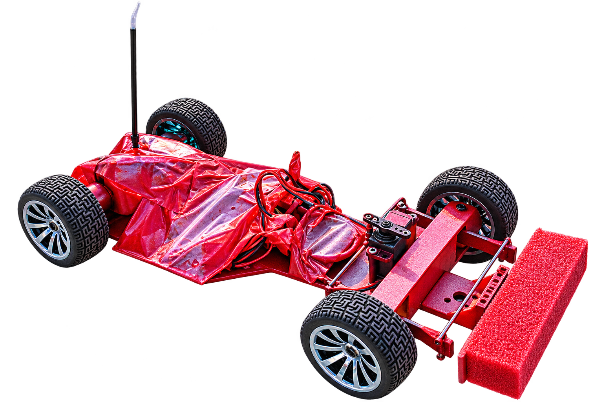
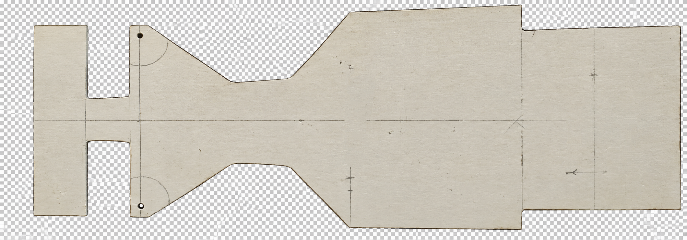

# 🏆 Le Mansar 2026 Winning RC Car




**A lightweight, balanced, hand-built 1/10-scale electric RC car that won the 24-minute endurance championship at Le Mansar 2026, IIT Jammu, and kept racing on three wheels after a crash.**

---

## 📖 Overview

This project is a custom-built **dual-BLDC electric RC racer** designed for the Le Mansar 2026 endurance championship, organised by Robo-Sapiens (Robotics Club, IIT Jammu). It won **1st place** in the 24-minute endurance race with **28 laps**.

Many teams built expensive, heavily engineered cars. This one went the other way: lighter, simpler and smarter.

The design prioritises:

- Low weight and simple construction
- Balance over complexity
- Reliability over a full 24-minute race
- Easy repair in the pit lane
- Compliance with the original chassis rules

---

## 🏁 Race Result

| Item | Detail |
| ---- | ------ |
| Event | Le Mansar 2026, IIT Jammu |
| Organiser | Robo-Sapiens, Robotics Club, IIT Jammu |
| Venue | Mansar Building, IIT Jammu |
| Format | 24-minute continuous endurance |
| Result | 🥇 **1st place (#1)** |
| Laps completed | **28 laps** |
| Represented | Robotics Club X E-yantra, Central University of Jammu |

---

## ⚖️ The Three Wheel Moment

About 5 minutes into the race the car hit a rock on the track and **lost a front wheel**.

It did not stop. Because the car is **fully balanced**, it kept running on three wheels for the rest of the race and still finished with the most laps.

> Balance over complexity.

This was not planned, but it is the best proof of the design philosophy: a simple, balanced car degrades gracefully instead of failing outright.

---

## ✨ Features

### 🪶 Light and Simple Build

- Hand-cut PVC pipe base
- 3D-printed key parts
- Minimal parts count
- Easy to inspect and repair

### ⚖️ Fully Balanced

- Weight distributed evenly across the chassis
- Stable handling on four wheels
- Still drivable on three wheels
- Predictable behaviour after damage

### ⚡ Dual BLDC Powertrain

- 2 brushless motors
- 2 SimonK 30A ESCs
- Large 5200 mAh battery for the full 24 minutes
- Run at only about 10% to 15% of top speed for reliability

### 📡 2.4 GHz Radio Control

- FlySky transmitter
- Servo steering
- Interference-free racing with multiple cars on track

### 🛡️ Crash Tolerant

- Foam bumper at the front
- Body film covering the electronics
- Rubber on-road tires
- Survived a rock strike mid-race

---

## 🚀 Speed

| Metric | Value |
| ------ | ----- |
| Theoretical maximum speed | about 150 km/h |
| Speed used in the race | about 10% to 15% of maximum |
| Approximate race speed | about 15 to 22 km/h |

The car was deliberately run far below its limit. In a 24-minute endurance race, finishing every lap matters more than top speed, so the throttle was kept low to protect the motors, ESCs, battery and tires.

---

## 🏗️ System Architecture

```
FlySky Transmitter
        │
        ▼
 2.4 GHz Receiver
        │
   ┌────┴─────────┐
   ▼              ▼
Steering Servo   2x SimonK 30A ESC
                  │
                  ▼
              2x BLDC Motors
                  │
                  ▼
              Wheels / Drive

 5200 mAh Battery ──► ESCs ──► Receiver and Servo
```

---

## 🛠️ Hardware Components

| Component | Quantity | Notes |
| --------- | -------- | ----- |
| BLDC Motor | 2 | Dual motor drive |
| SimonK 30A ESC | 2 | One per motor |
| Battery | 1 | 5200 mAh |
| FlySky Controller and Receiver | 1 | 2.4 GHz |
| Steering Servo | 1 | Front steering |
| PVC Pipe | As needed | Hand-cut chassis base |
| 3D-Printed Parts | As needed | Key structural parts |
| Rubber On-Road Tires | 4 | Maze tread pattern |
| Foam Bumper | 1 | Front impact protection |
| Body Film | 1 | Covers electronics |

---

## 📐 Chassis

The chassis is hand-cut and designed by the team, as the competition requires. No off-the-shelf RC car chassis was used.



The plate outline was hand-cut and marked with centerlines and mounting holes before assembly, with a narrow neck between the front and the wide body section.

---

## 📏 Competition Rules Summary

Key limits from the official Le Mansar regulations:

| Parameter | Limit |
| --------- | ----- |
| Maximum track width | 200 mm |
| Wheelbase | 250 mm to 300 mm |
| Maximum length | 460 mm |
| Minimum ground clearance | 5.0 mm |
| Minimum weight | 1300 g, ready to run |
| Motors | Maximum 2 |
| Battery | LiPo or Li-Ion, maximum 6S |
| Radio | 2.4 GHz with active failsafe |
| Tires | Rubber or foam, on-road |
| Chassis | Custom built, off-the-shelf chassis disqualified |

### Scoring

| Event | Format | Weight |
| ----- | ------ | ------ |
| A: 24-Minute Endurance | Most laps wins | 70% |
| B: Flying Lap | 3 laps, fastest single lap | 15% |
| C: Speed Trap | Straight-line radar run | 15% |

---

## 🧠 Design Philosophy

1. **Light beats heavy.** Less weight means less stress on motors, tires and battery.
2. **Simple beats complex.** Fewer parts means fewer failure points over 24 minutes.
3. **Balance beats power.** A balanced car stays controllable even after damage.
4. **Finish beats fast.** Endurance is won by lap count, not top speed.

---

## 🔧 Race Strategy

- Run at low throttle, about 10% to 15% of top speed
- Avoid motor and ESC overheating
- Keep a clean racing line and avoid contact
- Avoid track cutting and ramming penalties
- Keep the car repairable in the pit lane
- Never rely on a single heavy, fragile part

---

## 🚀 Build Your Own

1. Cut the PVC pipe base to your chassis layout
2. Print the key parts (mounts and brackets)
3. Mount the 2 BLDC motors
4. Wire each ESC to its motor
5. Connect the ESCs and servo to the receiver
6. Bind the FlySky transmitter to the receiver
7. Calibrate ESC throttle range
8. Secure the battery in a rigid mount
9. Balance the car left to right and front to back
10. Test at low throttle before racing

---

## 🔍 Troubleshooting

### Car Pulls to One Side

- Check that both motors are at the same throttle calibration
- Check wheel alignment and servo center
- Re-balance the weight

### Motor Spins the Wrong Way

Swap any two of the three motor wires.

### Car Does Not Respond

- Re-bind the transmitter and receiver
- Check ESC and receiver connections
- Check battery voltage

### Overheating

- Lower the throttle limit
- Improve airflow around the ESCs and motors
- Reduce weight

---

## 🛡️ Safety Notes

- Always strap the battery down firmly before running
- Never run with a damaged or swollen LiPo battery
- Disconnect the battery before working on wiring
- Keep hands clear of the wheels when powered
- Test the radio failsafe before every race

---


## 📂 Repository Structure

```
le-mansar-2026-winning-rc-car/
│
├── README.md
├── LICENSE
└── assets
     ├── car.png
     └── chassis-plate.png
```

---

## 🚀 Future Improvements

- Telemetry for battery voltage and temperature
- Better cooling for the ESCs
- Lighter body and chassis
- Lower-drag bumper design
- Full CAD files and BOM in this repo
- Tuning for the Flying Lap and Speed Trap events

---

## 🤝 Contributing

Contributions are welcome.

1. Fork the repository
2. Create a feature branch
3. Commit your changes
4. Submit a pull request

---

## 📜 License

This project is licensed under the MIT License.

See the `LICENSE` file for more information.

---

## ⭐ Support

If you found this project useful:

- ⭐ Star the repository
- 🍴 Fork the project
- 📢 Share it with the robotics community

Happy Racing! 🏎️🏆
